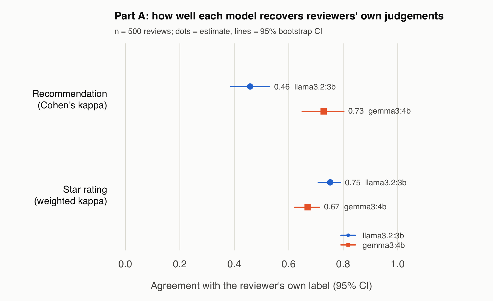
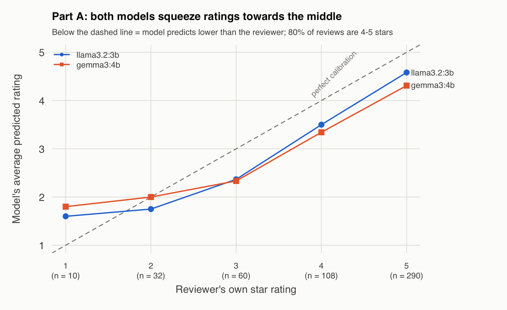
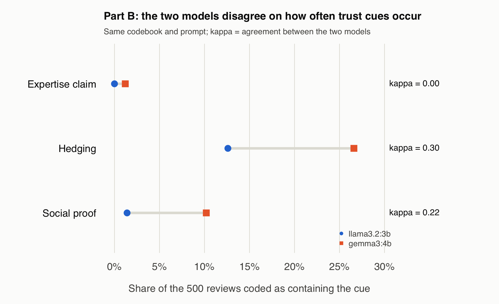

# llm-annotation-validation

**Can small, free, locally run language models annotate consumer reviews
reliably?** This project tests two open models on 500 clothing reviews in two
ways: against labels the reviewers gave themselves, and against each other on
three trust cues (expertise claims, hedging, social proof). Everything runs on
an 8 GB laptop at no cost: the models run locally through Ollama, and all
sampling, model calls and analysis are scripted in R.

## Key findings

1. **How well overall opinion is captured depends on the task and the
   model.** Agreement with reviewers' own labels ranged from kappa 0.46 to
   0.75. Neither model was better at both tasks: gemma3:4b was clearly better
   at predicting recommendations, llama3.2:3b slightly better at star ratings.
   llama3.2:3b's recommendation accuracy (0.76) was below the 0.83 obtained by
   always answering "recommends".
2. **Both models under-rated reviews on average.** The mean predicted minus actual rating was -0.43 (llama3.2:3b) and -0.61 (gemma3:4b). The shift was downward for 3 to 5 star reviews (91.6% of the sample), near zero or slightly low for 2 star reviews, and upward only for the 10 one-star reviews, too few to interpret. The models therefore read most reviews as more negative than their authors meant.
3. **On subtler concepts the models disagree.** Given the same codebook and
   prompt, the two models agreed only weakly on trust cues (kappa 0.00–0.30),
   and one coded social proof seven times as often as the other. Social proof was associated with fewer helpfulness votes under both models' coding (IRR 0.55 and 0.29), but the confidence intervals overlap widely, the llama3.2:3b estimate rests on only 7 coded reviews, and only the gemma3:4b estimate reaches p < 0.05, which does not survive correction for six tests.

The practical lesson: LLM annotations should be validated for each task and
each concept, and substantive conclusions checked across models, before they
are used in research.







## Data

[*Women's E-Commerce Clothing Reviews*](https://www.kaggle.com/datasets/nicapotato/womens-ecommerce-clothing-reviews)
(Kaggle): 23,486 reviews with title, text, star rating (1–5), whether the
reviewer recommends the item, and `Positive Feedback Count`, which Kaggle
describes as "the number of other customers who found this review positive".
This project reads that count as a signal of how helpful other shoppers found
the review and calls it "helpfulness votes" below; that reading is an
interpretation, not the dataset's own label. The raw file is not included in
this repository; download it from Kaggle and place it in `data/raw/` (see
*Reproduce*).

- Reviews with neither title nor text were dropped (844), leaving 22,642.
- 30 reviews were set aside for an early pilot and excluded.
- A simple random sample of **500 reviews** (`set.seed(2026)`) was analysed.
  Title and text were joined into one text field.

## Design

| | Part A: validation against reviewers' own labels | Part B: trust cues |
|---|---|---|
| Question | Can the model recover what the reviewer said about the item? | Do two models apply the same trust-cue definitions consistently, and do the cues predict helpfulness? |
| Model sees | Review text only | Review text only |
| Model outputs | Recommends (yes/no); star rating (1–5) | `expertise_claim`, `hedging`, `social_proof` (present/absent) |
| Benchmark | Reviewer's own `Recommended IND` and `Rating` | The other model; `Positive Feedback Count` |
| Primary metrics | Cohen's kappa (recommendation); quadratic-weighted kappa (rating) | Cohen's kappa between models, per cue |

- **Models:** `llama3.2:3b` (Ollama ID `a80c4f17acd5`) and `gemma3:4b`
  (`68ceab7e468a`), run locally with Ollama 0.34.4.
- **Settings:** `temperature = 0`, `seed = 42`; replies constrained to a JSON
  schema. Identical settings give identical output: re-asking 5 reviews per
  model and part reproduced 20 of 20 stored answers (see `AI_USE_LOG.md`,
  session 9).
- **Prompts:** [`prompts/part_a_v0.txt`](prompts/part_a_v0.txt) and
  [`prompts/part_b_v0.txt`](prompts/part_b_v0.txt). No prompt was changed
  after results were seen.
- **Codebook:** [`codebook/codebook_v1.md`](codebook/codebook_v1.md), based on
  source credibility (Hovland et al., 1953; Ohanian, 1990), hedging (Lakoff,
  1972; Hyland, 1998) and social proof (Cialdini, 1984). The definitions are identical to codebook_v0.md, which was committed before the Part B run, and reached the models through the Part B prompt.
- **Pre-specification:** each evaluation script's metrics were written before
  the script was first run on real results, as recorded in `AI_USE_LOG.md`.
  For Part A the script and its results share one commit, so git alone cannot
  show the order. The second model, gemma3:4b, was added after llama3.2:3b's
  Part A results had been seen. Deviations: a cue that a model never codes is
  left out of that model's regression, and three Part B calls that timed out
  were re-run with identical settings.
- **Uncertainty:** 95% percentile bootstrap CIs (2,000 resamples).

## Results

### Part A: agreement with reviewers' own labels (n = 500)

| Metric | llama3.2:3b | gemma3:4b |
|--------|-------------|-----------|
| **Recommendation, Cohen's kappa** | **0.46** (0.39–0.53) | **0.73** (0.65–0.80) |
| Recommendation accuracy (always "yes" = 0.83) | 0.76 | 0.92 |
| Recall, "not recommended" | 0.99 | 0.87 |
| Precision, "not recommended" | 0.42 | 0.70 |
| **Star rating, weighted kappa** | **0.75** (0.71–0.79) | **0.67** (0.62–0.71) |
| Rating exact / within one star | 0.56 / 0.94 | 0.42 / 0.93 |
| Spearman's rho | 0.79 | 0.77 |

llama3.2:3b labels most reviews that mention any flaw as "not recommended"
(117 of 415 recommending reviewers), so its accuracy falls below the
always-"yes" baseline. Model differences are descriptive; the CIs are per
model, not a paired test.

### Part B: how often each cue is coded, and agreement between models (n = 500)

| Cue | gemma3:4b | llama3.2:3b | Kappa (95% CI) |
|-----|-----------|-------------|----------------|
| Expertise claim | 1.2% | 0.0% | 0.00 |
| Hedging | 26.6% | 12.6% | 0.30 (0.20–0.39) |
| Social proof | 10.2% | 1.4% | 0.22 (0.08–0.36) |

Gwet's AC1 is also reported in `outputs/part_b_agreement.csv` but is not
interpreted: it is high for rare cues even under random coding (0.87 in a dry
run on random data).

### Part B: do cues predict helpfulness votes?

Negative binomial regression of helpfulness votes on the three cues,
controlling for log word count and star rating. Incidence rate ratios (IRR)
with 95% CIs; IRR > 1 means more votes when the cue is present.

| Term | Coded by gemma3:4b | Coded by llama3.2:3b |
|------|--------------------|----------------------|
| Expertise claim | 1.45 (0.36–5.83) | not estimable (never coded) |
| Hedging | 0.84 (0.58–1.22) | 0.86 (0.52–1.41) |
| Social proof | 0.55 (0.32–0.94), p = 0.03 | 0.29 (0.07–1.30), p = 0.11 |
| Log word count | 1.54 (1.15–2.08) | 1.50 (1.12–1.99) |

Only review length predicts votes consistently. The social-proof estimate reaches p < 0.05 under one model's coding only, and would not survive a correction for six cue tests (Bonferroni threshold 0.008). The two estimates point the same way and their intervals overlap.

## Limitations

- **No human coding of trust cues.** Part B shows that the models disagree,
  not which one is right.
- **Reviewers' labels are an imperfect benchmark.** 22 of the 60 3-star
  reviewers still recommend the item; no reader could reach perfect agreement.
- **Rare cues.** Expertise claims are too rare in 500 reviews to analyse.
- **Small models only.** Larger models may agree more; this project tests
  what is feasible on an 8 GB laptop.
- **Helpfulness votes** are skewed (46% of reviews have none) and depend on
  how long a review was visible, which the data do not record.

## Reproduce

Requirements: R 4.5 with `readr` (2.2.0), `httr2` (1.3.0), `jsonlite` (2.0.0)
and `MASS` (7.3.65); [Ollama](https://ollama.com) 0.34.4 with the two models.

Start the Ollama server in one terminal and leave it running:

```bash
ollama serve
```

In a second terminal, download the models and check their IDs:

```bash
ollama pull llama3.2:3b
ollama pull gemma3:4b
ollama list
```

The IDs should be `a80c4f17acd5` (llama3.2:3b) and `68ceab7e468a`
(gemma3:4b). Model tags can be updated over time; a different ID means a
different model version, and results may differ.

Place `Womens Clothing E-Commerce Reviews.csv` in `data/raw/`, then run from
the repository root, in order:

| Script | What it does | Time on an M2, 8 GB |
|--------|--------------|---------------------|
| `scripts/00_inspect_data.R` | Describes the raw data | seconds |
| `scripts/01_make_pilot_sheet.R` | Sets aside 30 pilot reviews | seconds |
| `scripts/02_draw_sample.R` | Draws the 500-review sample | seconds |
| `scripts/04_run_part_a.R <model>` | Part A annotation | 7–16 min per model |
| `scripts/05_evaluate_part_a.R` | Part A metrics | seconds |
| `scripts/06_run_part_b.R <model>` | Part B annotation | 10–64 min per model |
| `scripts/07_evaluate_part_b.R` | Agreement between models | seconds |
| `scripts/08_predict_helpfulness.R` | Helpfulness regressions | seconds |
| `scripts/09_make_figures.R` | Figures | seconds |

`scripts/03_test_llm.R` is a 5-review smoke test. Review text is written only
to `data/private/`, which is git-ignored; `outputs/` contains predictions and
statistics only.

## AI assistance

This project was built with help from an AI coding assistant (Claude Code).
What the AI did and what the author decided is documented session by session
in [`AI_USE_LOG.md`](AI_USE_LOG.md).

## Licence

Code: MIT (see [`LICENSE`](LICENSE)). The dataset is released under CC0:
Public Domain (per its Kaggle page). The models have their own terms: the
Llama 3.2 Community License and the Gemma Terms of Use.
